# Architecture

How each kind of request moves through the deployables, how a run moves through its states, and where every record lives. The service and deployment diagrams are on the [overview](index.md). Paths are relative to the repo root.

## The system

Traefik is the only public door. `apps/edge/src/routes.ts` is the route table, in priority order, and `verification/Broods/Gateway.lean` models it. The first router that matches wins; trailing slashes are stripped first.

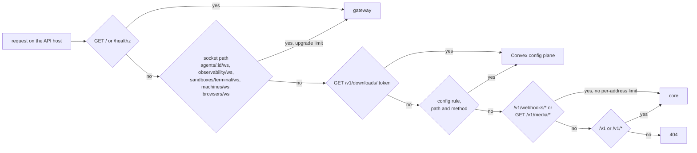

- Config rules are method-aware. A method miss falls through to core, so `DELETE /v1/account` reaches core while `GET /v1/account` reaches Convex.
- Every router stamps `x-broods-via-gateway` and strips `X-Account-Id`. Core and the config plane refuse the service token on a stamped request, so in-cluster paths such as `/v1/cron-runs` need no special route.
- Core has no host of its own. `apps/core/src/server.ts` routes by path: `/healthz`, media, the account verbs (`routesToAccountManage`), then the harness handler.

## Request paths

### Direct run over HTTP

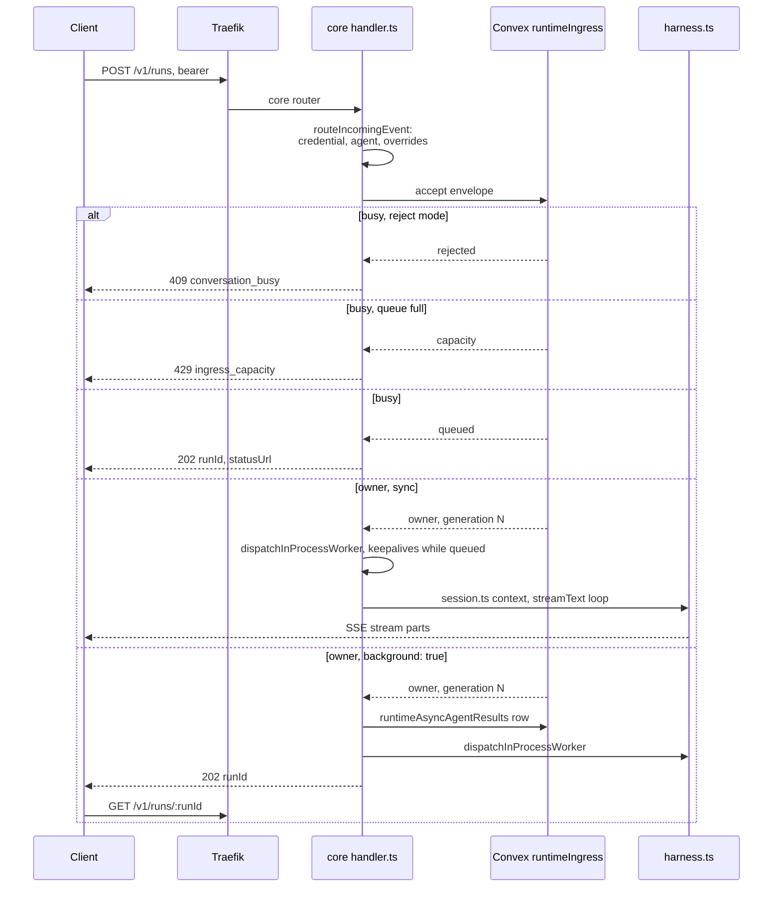

- Also `POST /v1/projects/:p/stages/:s/agents/:endpointId`. `ENABLE_DIRECT_API` gates both, default `true`.
- A duplicate idempotency key answers with the first admission's run id. The same key with a different payload is `409 idempotency_conflict`.
- In-process workers are capped by `MAX_INPROCESS_WORKERS`, default 8, streamed and background runs alike. A full worker queue turns a new streamed or background run away with `503` and `Retry-After` before the plan counts it or ingress records it, so a retry with the same `eventId` starts it; an account out of budget gets its `402` or `429` first, read without counting (`admitRun` with `count: false`). A request that got past that check holds one queue place while it is admitted (`withQueuePlace`), so concurrent requests never admit more runs than the queue takes and its run is never shed once recorded. A channel message holds one the same way; [channels](channels.md#runtime-flow) has what a full queue answers each provider. Queue modes: [queue and steer](queue-and-steer.md).

### WebSocket run

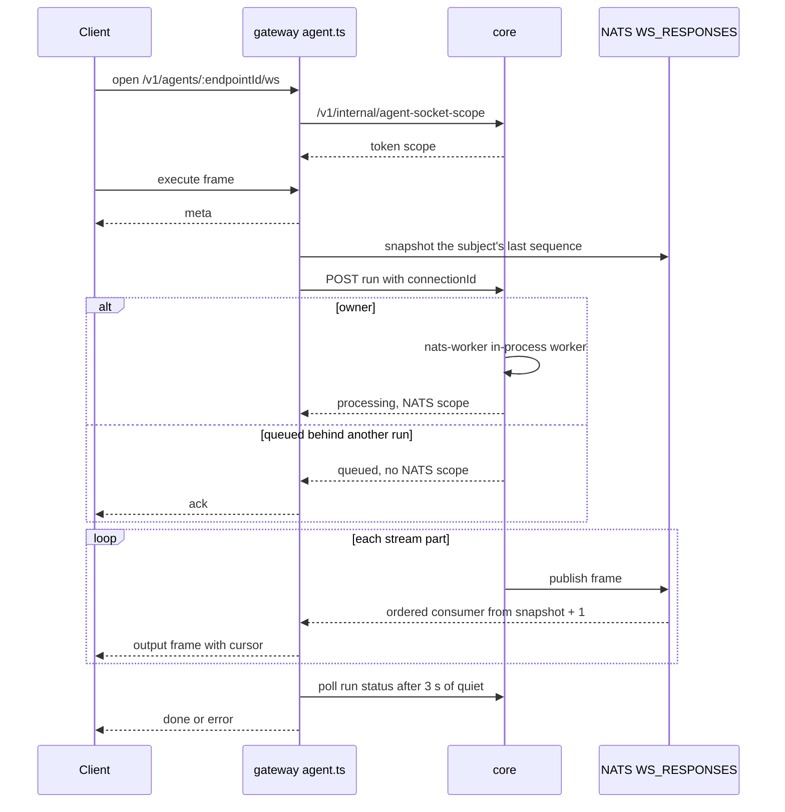

- The credential rides `Sec-WebSocket-Protocol`: the stage's runtime key or a member's stage ticket. The scope lookup is the door check: it binds the socket to the credential's account and stage endpoint. Every frame after it reaches core with that same credential, so `execute` and `control` pass the run checks and `attach` the status read, exactly as over HTTP: a runtime key reaches only the public agents of its stage. The gateway reads NATS only for a run core admitted, and an attach replays only the run its `runId` names.
- Needs `ENABLE_WEBSOCKET=true` and `NATS_URL`. Attach, replay and control frames: [queue and steer](queue-and-steer.md).

### Channel webhook

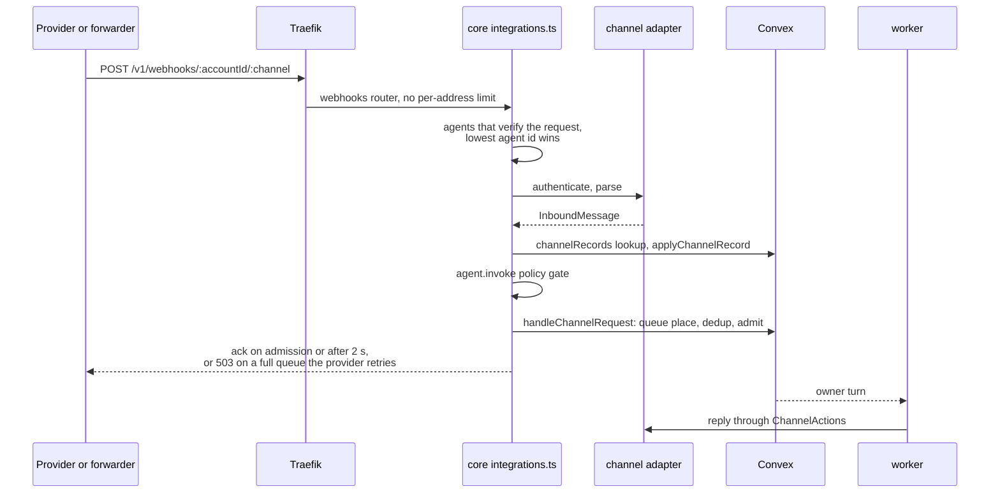

- Stage URL: `/v1/webhooks/:accountId/dev/:endpointId/:channel`. One that resolves to no agent is `404`.
- Discord messages and all Matrix traffic come from the two forwarders, posting to the same URL. Matrix replies go back through the matrix-forwarder's `/v1/send`, since only it holds the room keys.
- Unsigned requests are answered from an agent listing cached up to 10 seconds; a request that verifies lists again uncached. Detail: [channels](channels.md).

### Cron fire

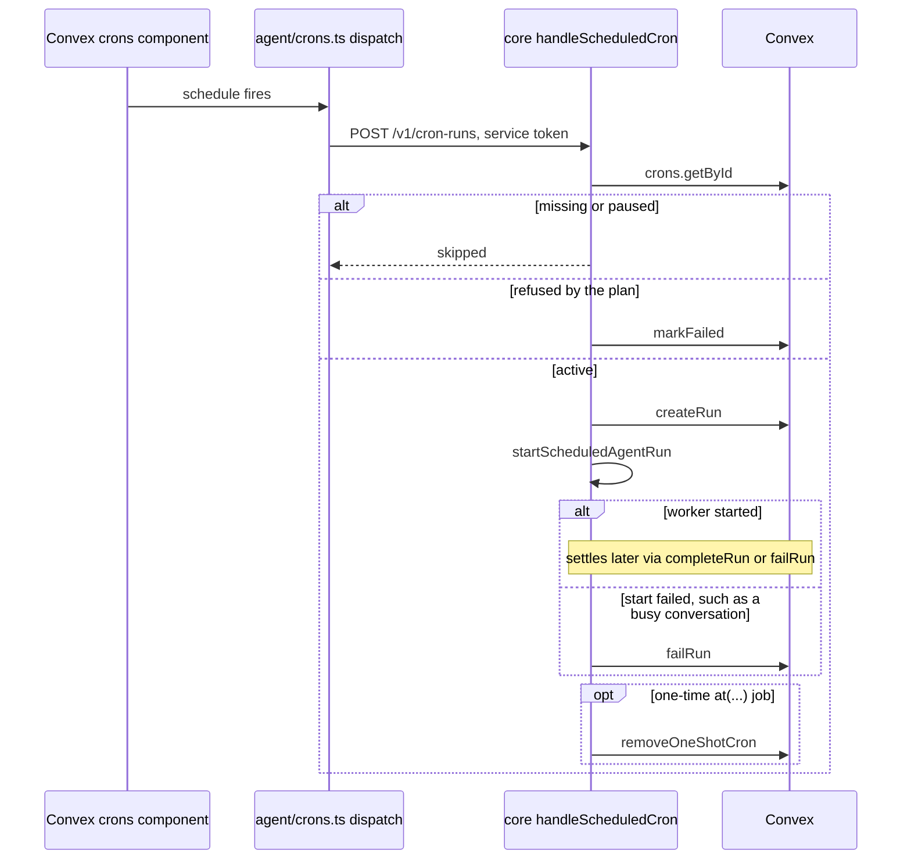

- `dispatch` posts to core's in-cluster `BROODS_ACCOUNT_MANAGE_URL`. From outside, the stamped header makes the service token invalid and core answers `401`.
- The job's `lastStatus` follows its latest run row, so a late older run cannot overwrite a newer one (`verification/Broods/Cron.lean`).
- A conversation key that names a live channel session resumes it and replies there.

### Config-plane call

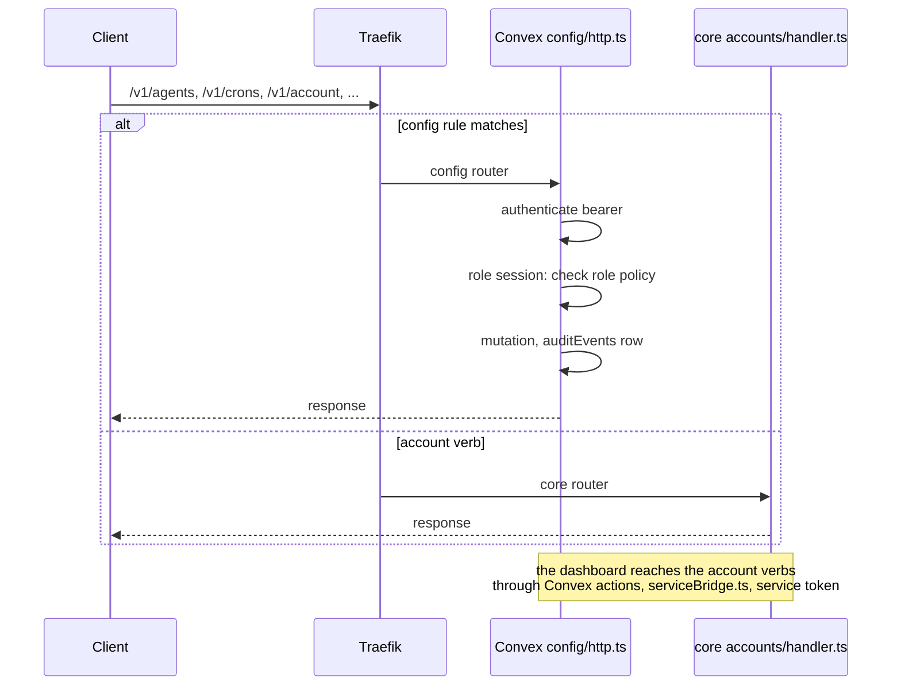

- Account verbs on core: `POST /v1/accounts`, `DELETE /v1/accounts/:id`, `DELETE /v1/account`, and `POST /v1/sandboxes/:id/` with `suspend`, `resume`, `terminate`, `snapshot`, `refresh`, `exec` or `terminal`.
- Handlers live in `packages/convex/config/routes/*`. Role management needs the account key.

### CLI sync

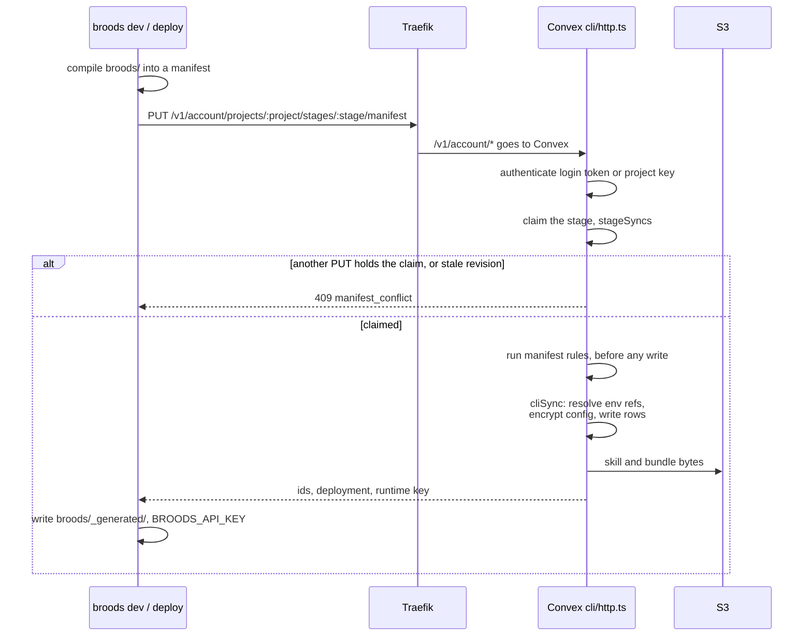

- `broods dev` sends the revision it read; `broods deploy` sends none and replaces the last completed sync.
- The claim is released in `finally`; an abandoned claim expires after 45 minutes.
- `verification/Broods/Sync*.lean` proves the next diff after a sync is deletes only and that overlapping PUTs are refused.

## Run lifecycle

A run is one `runtimeIngressEnvelopes` row, the record behind `GET /v1/runs/:runId`. `packages/convex/runtimeIngress.ts` moves it; `verification/Broods/Ingress.lean` proves every step moves forward and terminal states stay terminal.

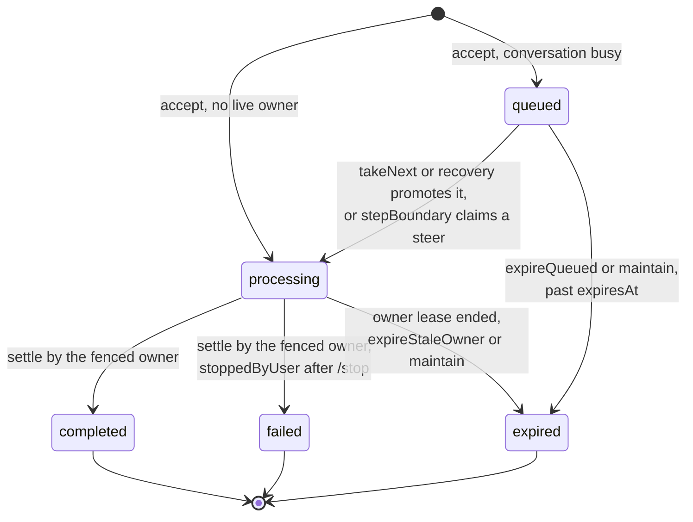

- Admission outcomes that write no row: `rejected` (409), `capacity` (429), `conflict` (409), `duplicate` (the first run's id) and `not_running` (a late control).
- Every owner write is fenced by owner event, generation and a live lease. `/stop` sets `stopRequestedGeneration`; the next step boundary stops and claims nothing.
- `maintain` extends `expiresAt` instead of expiring a run its owner still holds.
- The public status type also has `accepted` and `applied`; no row is stored with them.
- Status rows are kept 7 days. The polling row of an async run (`runtimeAsyncAgentResults`: `processing`, `awaitingApproval`, `awaitingInput`, `completed`, `failed`) settles in the same `settle` mutation (`verification/Broods/AsyncResults.lean`).

## Credentials

| Credential           | Prefix  | Checked by                                                         |
| -------------------- | ------- | ------------------------------------------------------------------ |
| Runtime key          | `bsk_`  | core (`src/shared/auth.ts`); the gateway checks agent socket scope |
| Stage session ticket | `bdts_` | core, `STAGE_TICKET_SECRET`; Convex signs it, 15 minutes           |
| Account key          | `bask_` | core and the config plane                                          |
| Role session         | `bsts_` | core and the config plane, then the role's policy, up to 12 h      |
| CLI login            | `bcli_` | Convex `cli/http.ts`                                               |
| Project key          | `bpdk_` | Convex `cli/http.ts`                                               |
| Admin secret         | none    | core, `ADMIN_ACCOUNT_SECRET`, self-hosted account creation         |
| Service token        | none    | core, only with `X-Account-Id` and no `x-broods-via-gateway`       |
| Terminal ticket      | sealed  | gateway, `TERMINAL_TICKET_SECRET`; core seals it                   |
| End-user token       | `buat_` | core, beside a runtime key, under the stage's `bsig_` secret       |
| Browser ticket       | `bbt_`  | core, on the browser socket, under the stage's `bsig_` secret      |
| Per-job token        | none    | core, against the `runtimeAsyncToolResults` row                    |

Channel webhooks use each provider's own signature, checked by the adapter. The gateway holds only `TERMINAL_TICKET_SECRET`, never the service token. Scopes, resolution order and rotation: [security](security.md) and [operations](operations.md).

## Where state lives

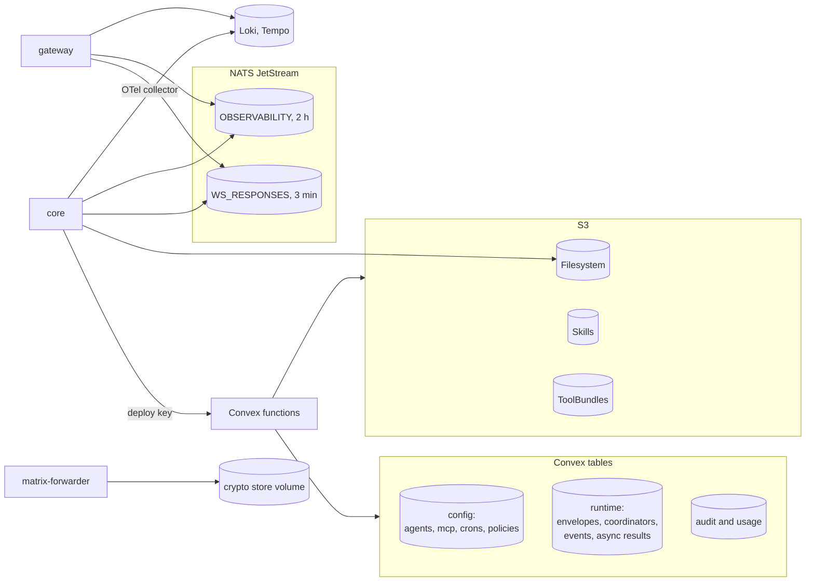

| Store                   | Holds                                                                    | Lifetime                            |
| ----------------------- | ------------------------------------------------------------------------ | ----------------------------------- |
| Convex tables           | Config, runtime state, audit, usage. `packages/convex/schema.ts`         | Durable; run status 7 days          |
| S3 `Filesystem`         | Workspace files under `<namespace>/`, staged skills, channel attachments | Durable                             |
| S3 `Skills`             | Skill bundles under `<accountId>/<skill-name>`                           | Durable                             |
| S3 `ToolBundles`        | Code hook and hosted MCP bundles under `account-mcp/`                    | Durable; R2 copy expires in 30 days |
| NATS `WS_RESPONSES`     | Agent stream parts per conversation, for WebSocket replay                | 3 minutes, 2,000 per subject        |
| NATS `OBSERVABILITY`    | Live logs and spans per stage, for dashboard replay                      | 2 hours                             |
| Loki, Tempo             | Long-term logs and traces, via the OTel collector                        | Per collector config                |
| Matrix forwarder volume | Each Matrix account's crypto store, sync token and outbox                | Durable; an outbox event 12 hours   |

Core reaches Convex with `ConvexHttpClient` and the deploy key (`apps/core/src/shared/convex/client.ts`). Byte layout: [storage](storage.md).

### Tenancy model

An org is the billing and login unit; its account is the tenant every runtime row keys on. Projects and stages scope config, keys and deployments.

On the managed service Pro belongs to the owner, not to one org (`packages/convex/model/orgBilling.ts`). Each owner has one Stripe subscription, filed under their user, to one €20 price: Pro is one unit and gives the owner two developer seats, and each seat past those is one more unit, so an owner with `d` developers pays `1 + max(0, d - 2)` units. The seats are one pool across every org the owner owns: a developer is any member of one of those orgs who is not the owner, counted once however many of them they are in. A Hobby (free) owner has no developer seats. `users.plan` follows the subscription, and every org the owner owns gets the same `orgs.plan`, recomputed on each subscription change; that is the plan core enforces for the org's account. An invite of someone already seated in another of the owner's orgs is free; anyone else needs a free seat, so with the pool full the owner adds one first: Stripe charges the prorated seat at once and refuses the change if the payment fails. Adding a seat makes room for one more developer and charges nothing when a seat is already free, so a retry or a second tab never pays twice. A developer leaving their last org of the owner's, deleting their account, or the owner deleting an org lowers the units to what the developers left need, never below what they pay now; deleting the owner's account cancels the subscription. Creating an org needs Pro: everyone gets their own Hobby workspace, a Pro owner creates up to 10 orgs, each starting on Pro, and anyone else is refused. A Hobby user still joins any org that invites them, on its owner's seat.

Usage caps are pooled per paying user: every org a Pro owner owns draws on one set of Pro caps (`usagePools`, keyed by the owner, written with each account's meter), so one €20 subscription carries one org's worth of Pro usage however many orgs it covers. Orgs stay free to create on Pro, up to 10 per owner.

The caps are the org's, shared by all its projects, and the meter also splits each day by project (`usageProjectDays`) so the dashboard can show who used what. Each write names its project as far as the writer knows it: the sandbox mirror from the instance's `projectId`, core's hosted MCP write from the server's project, egress from the workspace a media link points into, ingress from the agent the message was for (`account/budget.ts` `record`, `source`), and the daily storage snapshot from what each project's own workspaces hold. Account-wide sandboxes and workspaces, chat attachments, skills and bundles belong to no project, and neither does anything metered before the split existed; the organization's Usage page shows that as "Other usage", the org's total less its projects. A project's Usage tab shows Resources from that project: its amount against the caps, its part of each bar and day solid and the rest of the organization grey. The organization's Usage page (Settings → Organization → Usage) shows the same month from every project: each bar and day colored by project, and a table of every project's month (`api.account.budget.getForActiveOrg` with `withProjects`). Each bar is the owner's pool, the number that stops runs: this org's slices, then a faded part for the owner's other organizations, with an All organizations column and one note line saying the limits are shared. Core's admission check still reads one row, the owner's monthly pool, so the split costs a run nothing.

An owner who pays for more than one subscription (one per org under the older per-org billing) is billed on the paid one with the most units, the oldest on a tie, so no seat they paid for is lost (`currentOf` in `model/orgBilling.ts`). The other paid ones count for nothing; refund and cancel them by hand.

In the dashboard the Billing tab keeps the plan, the seats and the bill apart. Your plan shows the owner's plan, its price, that its limits are shared across the orgs they own, a table of every plan's limits (the monthly caps, runs per minute, orgs owned, developer seats) with the current plan marked, stacked one plan after the other on a phone, and how close the pool is to its closest cap; Developer seats, once the owner has a subscription or developers kept from before seats counted, shows how many of the owner's seats are used across their orgs, and lists each developer with the orgs they are in; What you pay each month adds Pro and its extra seats up. Only the owner gets Upgrade, Add seat, Manage subscription and the bill, and only the owner sees their seat count and billing period; anyone else sees whose plan the org runs on, its status and their own seat, and is never charged. When every seat is taken, the invite dialog asks the owner to pay for one more seat, to upgrade from Hobby, or to fix a failed payment in Manage billing, before the invite goes out; anyone else is told to ask the owner. New organization explains that it needs Pro and links to Upgrade. Account settings lists the orgs you own, each with its plan.

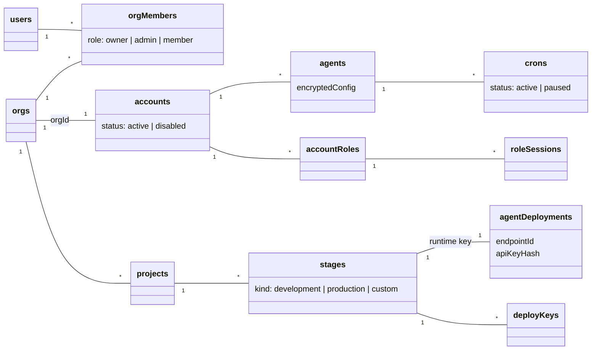

Config rows such as `mcp`, `sandboxConfigs` and `workspaceConfigs` also carry `projectId` and `stageId`. Rows the account REST API creates leave both unset and are shared across stages.

### Convex tables

| Group                 | Tables                                                                                                                                                                                                                      |
| --------------------- | --------------------------------------------------------------------------------------------------------------------------------------------------------------------------------------------------------------------------- |
| Identity and tenancy  | `users`, `orgs`, `orgMembers`, `orgRoles`, `accounts`, `accountKeys`                                                                                                                                                        |
| Projects and access   | `projects`, `stages`, `stageSyncs`, `agentDeployments`, `deployKeys`, `cliAuthCodes`, `cliTokens`, `accountRoles`, `roleSessions`, `permissions`                                                                            |
| Resource config       | `agents`, `agentConfigs`, `canvasLayouts`, `agentRuntimeSecrets`, `sandboxConfigs`, `workspaceConfigs`, `mcp`, `accountHooks`, `agentPolicies`, `channelRecords`, `channelEndpoints`, `connections`, `cliExternalResources` |
| Environment variables | `environmentVariables`, `accountEnvVars`, `environmentVariableReveals`                                                                                                                                                      |
| Schedules             | `crons`, `cronRuns`, plus the crons component's own tables                                                                                                                                                                  |
| Runtime               | `runtimeConversationEvents`, `runtimeHarnessSessions`, `runtimeClaims`, `runtimeConversationCoordinators`, `runtimeIngressEnvelopes`, `runtimeIngressApplications`, `runtimeAsyncAgentResults`, `runtimeAsyncToolResults`   |
| Sandboxes             | `sandboxReservations`, `sandboxInstances`, `sandboxSnapshots`, `sandboxAuditEvents`, `machineConnections`                                                                                                                   |
| Workspace files       | `workspaceFiles`, `workspaceDownloadTokens`, `uploadGrants`                                                                                                                                                                 |
| Billing               | `stripeSubscriptionSyncs`, plus the Stripe component's own tables                                                                                                                                                           |
| Audit and usage       | `auditEvents`, `auditChainHeads`, `auditSinks`, `configHttpAuthFailures`, `taskUsage`, `usageRollups`, `usageMeters`, `usageDays`, `usageProjectDays`, `usageWrites`                                                        |

## Async and deferred work

Run-local work stays in core's process: subagents are child loops, background runs are in-process workers, and code hooks run in a pooled V8 isolate (`src/harness/isolate`). Broods deploys no separate worker services. Hosted MCP calls run in the Workers runtime or on Lambda ([tools and MCP](tools-and-mcp.md)).

A detached sandbox job outlives its request:

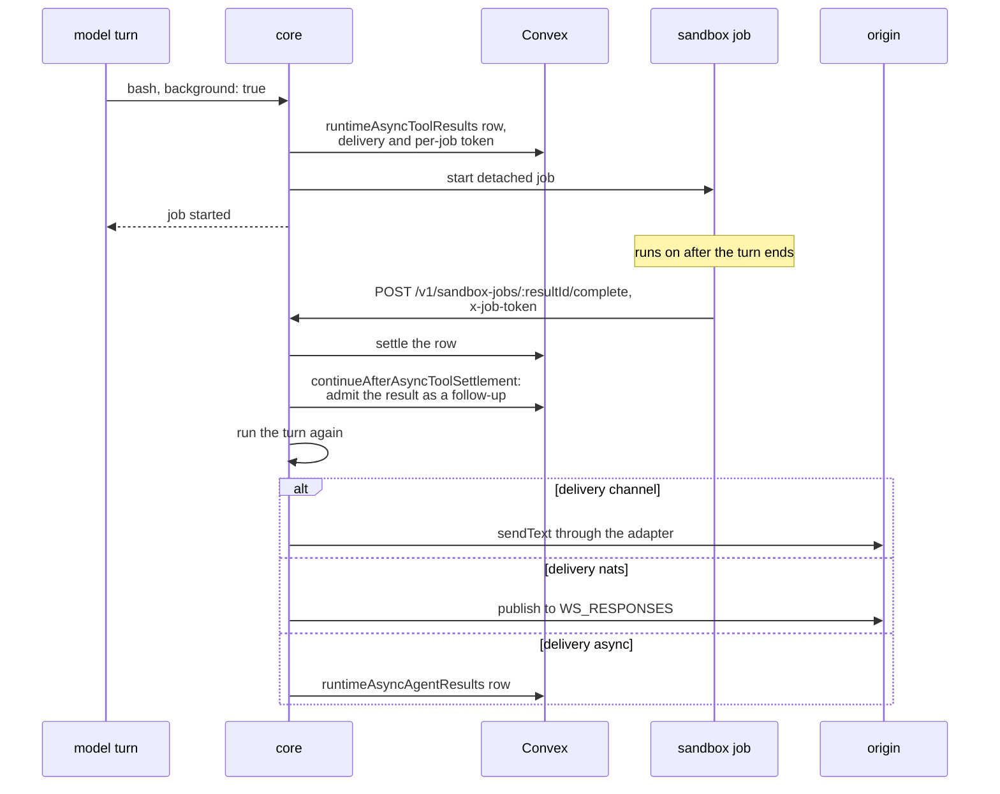

- A wrong or missing token reads as `404`, so the route is not a token oracle. A settled row answers `409`.
- The callback needs `PUBLIC_BASE_URL` and egress to it. Without the URL, a sandbox with job controls falls back to `async_status` polling and any other refuses the background job.

## WebSocket and JetStream contract

- Subject: `v1.<accountId>.<agentId>.ws.response.<convToken>`, `convToken` the `base64url` public conversation key. One publish per frame, no per-frame ack, so replay is best effort.
- `Nats-Msg-Id` (`eventId:sequence`) and a 2 minute duplicate window collapse retries.
- Cursors are opaque, bound to one event, and exclusive. A cursor the stream can no longer serve gets `replay_unavailable` and the durable status.
- Convex ingress status is the truth for acceptance and terminal state. JetStream only carries output.
- A frame over the server's `max_payload` goes out with `truncated: true`, `originalBytes` and no payload, so `done` still ends the stream.
- NATS is in-cluster only. `connectNats` in `apps/core/src/shared/nats.ts` picks TCP for `nats://` or `tls://` and WebSocket for `ws://` or `wss://`. Core shares one reconnecting connection for every stream, log and span (`apps/core/src/harness/nats-publisher.ts`).

Frames and attach: [queue and steer](queue-and-steer.md). Logs and traces on `OBSERVABILITY`: [observability](observability.md).

## Related pages

- [Sandboxes](sandboxes.md) and [storage](storage.md) for compute and files.
- [Channels](channels.md), [tools and MCP](tools-and-mcp.md) and [subagents](subagents.md) for each harness subsystem.
- [Security](security.md) for encryption, redaction and untrusted code tiers.
