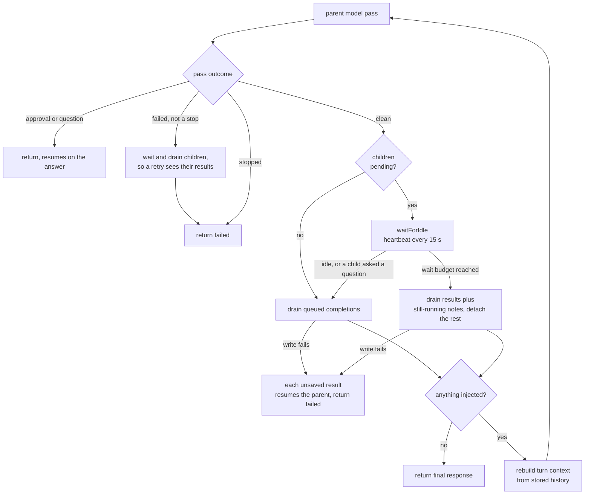
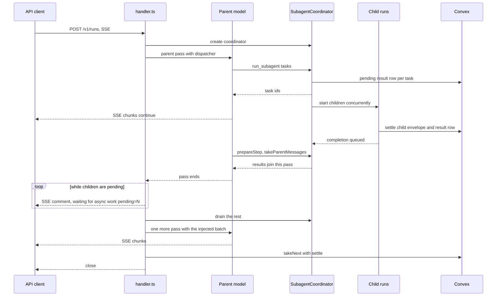
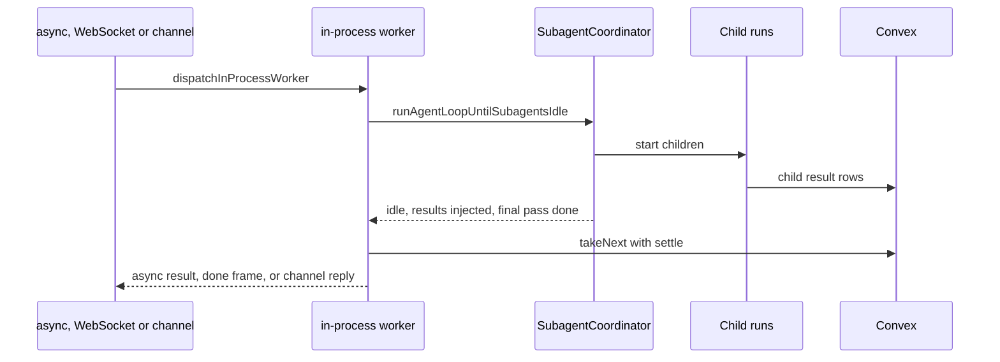
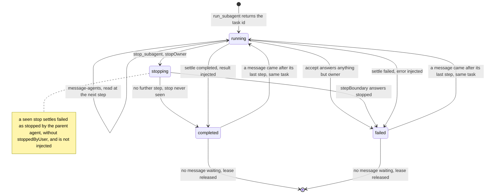
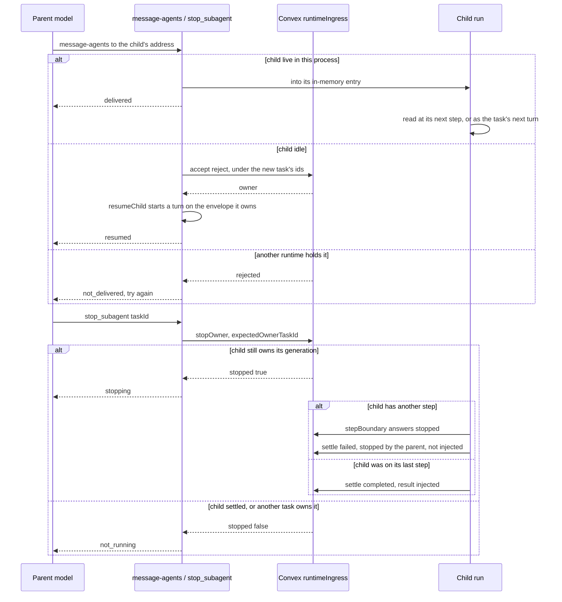
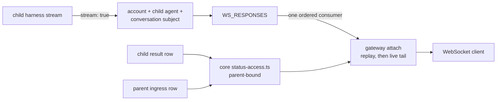
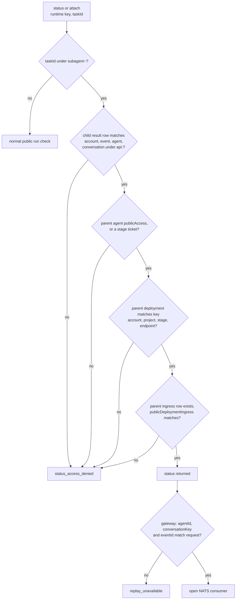

# Subagents

How subagent runs execute inside core: dispatch, the parent continuation loop, control of a running child, and who may watch a child's stream. Configuration and model-facing behavior are in the [subagents guide](../guides/subagents.md). Paths are relative to `apps/core/`.

| File                           | Owns                                                                                                  |
| ------------------------------ | ----------------------------------------------------------------------------------------------------- |
| `src/harness/subagents.ts`     | `SubagentCoordinator`: dispatch, child runs, the result and question queues                           |
| `src/harness/continuation.ts`  | `runParentContinuationLoop`, `waitAndDrainAsyncWork`, `runAgentLoopUntilSubagentsIdle`, `waitUntilMs` |
| `src/harness/handler.ts`       | the SSE heartbeat writer, the WebSocket `waiting` frames                                              |
| `src/harness/harness.ts`       | `prepareStep`, where queued child messages join the parent mid-pass                                   |
| `src/harness/tools/`           | `run-subagent`, `stop-subagent` and `message-agents` tools                                            |
| `src/harness/status-access.ts` | Who may read a child's status with a runtime key                                                      |

## Execution model

`run_subagent` creates a pending result row per task, returns the task ids at once, and starts the children as promises inside the same request or worker, not as separate processes. The parent's model stream keeps going.

A child result that arrives while the parent streams waits in the coordinator's in-memory queue. A child's `message-agents` to `"parent"` with `waitSeconds` is a result too: it ends the child's turn as `awaiting_input` with the message as `question` on its result row, so it rides the same queue, hand-back and recovery sweep. A note without `waitSeconds` is admitted to the parent conversation as a `steer` through `resumeAfterSubagentResult`, under a task id of its own and with no result row, before the child is told it was delivered; a live parent claims it at its next step boundary like any steer, and an idle one starts a turn on it. At the parent's next step boundary `prepareStep` takes it (`takeParentMessages`) and adds it as `user` messages, the same way a [steer](queue-and-steer.md#the-step-boundary) joins a run. What arrives after the pass goes through the continuation loop:

The wait budget ends 3 minutes before the request or worker deadline, or 8 minutes out when there is none (`waitUntilMs` in `continuation.ts`). The loop waits on subagents only: a detached background job or open question adds no pending work, and its result resumes the conversation on its own. When it runs out, `drainCompletionsAndDetachToParent` tells the parent each child still working is `running` and detaches it. A detached child keeps running, and its result resumes the parent conversation through `resumeAfterSubagentResult`: a `followup` continuation admitted once per task (`<root event>:async-subagent:<task nonce>`) on the delivery of the turn that started it, the same path a settled background job takes. Until then the parent root span ends `waiting` on `subagent`. A queued question ends the wait early so the parent can answer while other children keep running. Results, `running` notices and questions reach the parent transcript in one write. A write too large for one append takes several, and a failed one at a step boundary puts back only what no append saved, for the next step. Each row carries a dedupe key, the child's result event id and status or a question's own id, and `runtimeConversationEvents` stores one row per key in a conversation, so a write that committed but lost its reply is not stored again by that retry. The pass's last write (`drainCompletionsToParent`, which the detach ends with too) has no next step: when it fails the run fails, and each finished result no append saved resumes the parent through `resumeAfterSubagentResult` like a detached child's, its row marked `detached` first so the recovery sweep retries a resume that fails too. Each child still working is detached the same way (`detachPending`), so its result resumes the parent too, and a question it asks wakes it at once. Unsaved `running` notices are dropped, since those children report back themselves. `runtimeIngress.accept` refuses a late resume as a duplicate when the parent conversation already stores that result's dedupe key, under either finished status, and marks the row stored. When the store also refuses the `detached` write and the resume, the row stays `pending`, and the recovery sweep delivers it once no live parent run can still be holding it; so does every result of a parent run that dies before it stops waiting.

### Late results are told once, and survive a restart

Whether the parent has a result is kept on the child's `runtimeAsyncAgentResults` row, not in memory. `run_subagent` writes each row with `subagent`: the task's description and where the parent answers (its conversation key and delivery). The task id, the child agent and its public key come from the row's own `eventId` and `conversationKey`. The `handback` field then moves one way:

| `handback` | Set by                                                                                                                                                                                                                                                               | Means                                                                          |
| ---------- | -------------------------------------------------------------------------------------------------------------------------------------------------------------------------------------------------------------------------------------------------------------------- | ------------------------------------------------------------------------------ |
| `pending`  | `run_subagent` creating the row (`createAsyncAgentResult`)                                                                                                                                                                                                           | the parent's live run owes the result its write                                |
| `detached` | `detachPending` (`markAsyncAgentHandback`), for a child whose result that pass has not handled, or a result the pass's failed last write did not save                                                                                                                | the parent stopped waiting, or its write failed, and the sweep owns the result |
| `stored`   | the parent's own append of the result (`insertConversationEvents`, under the result's dedupe key), the owner's save of the late resume, a duplicate refusal because the conversation already holds it, or a result the parent is never told or the sweep gives up on | the parent has it, and nothing tells it again                                  |

A child whose current turn's result is already queued is only letting its lease go, so the detach leaves it alone; once a later turn of its task starts, the task is that turn, and the detach covers it. A row still running is never marked stored, and a failed write only logs. The late resume passes the row as `resultEventId` to `runtimeIngress.accept`, which admits the continuation only while the row, of the caller's own account, is not `stored`. The resume's message carries the result's dedupe key, the one the parent's own append uses, so the owner that saves the message (`insertOwnedEvents`) stores the row in that write, and a retry of a write whose reply was lost saves it once. While that continuation is queued or applied, any other resume of the row is refused as a duplicate (`liveResumeOf`, indexed by the result id), whatever its event id. A history write that stores the result some other way, such as the parent's own append, completes a resume of it still queued. Only a write to the parent's own conversation, of the row's account, stores it. Handing the resume to an owner stores nothing: an owner that never saves the message, because it died or never saw a claim whose reply was lost, leaves the row unstored. A continuation that ends before it is saved, expired (queued 15 minutes, or with its owner's lease), failed or settled, leaves the row as it was, so the sweep lists it again, and its retry replaces that envelope instead of answering a duplicate. `verification/Broods/AsyncResults.lean` proves a late result reaches the parent at most once, never through a resume after the row is stored, that a resume whose owner dies before saving it is told again by the sweep's next one, and that it resumes again after a queued resume of it expired.

The ingress recovery sweep (`ingress-recovery.ts`, on boot and every 30 s, after the queue pass and whether or not it failed) runs `resumeLostSubagentResults` over rows still `detached`, written between a day and 2 minutes ago, and rows still `pending` written more than one run budget plus wind-down plus that grace ago (no live parent run can hold a result longer), of active accounts; each pending one is logged, since a parent run dropped it without a trace. Each pass walks every page, per status, so rows it has to retry never crowd the rest out. A finished one is a result whose run died before it resumed the parent, or whose resume failed: it gets the same finish hook and visibility decision, on the parent's re-entry config (`loadReentryTarget`), then the same `resumeAfterSubagentResult`, and is logged as resumed only once a conversation admitted it. A conversation with no room (`capacity`), a resume the sweep queued, a duplicate of a resume still queued, or a resume that throws keeps the row for the next pass, which reuses the message the hook already shaped instead of running it again. A duplicate is never given up: admission marks the row stored itself once the conversation has the result, and answers a retry of a resume still queued as a duplicate even when its payload drifted (a hook rewrite, a model redeploy), so it is never refused as a conflict. A row no resume can deliver is marked `stored` and logged once: its parent agent is gone, its task id names another account, the result is hidden from the parent, or the continuation was refused as a conflict. A row still `processing`, `pending` or `detached`, is listed only past the child budget plus wind-down plus that grace, so running children never sit in the way; such a child died with its pod: the sweep fails the row with `Subagent stopped without a result: the runtime restarted while it was running.`, in one mutation that leaves it alone if its outcome landed meanwhile, marks a `pending` one `detached` since its parent run is gone too, and a later sweep tells the parent that like any other result. A follow-up turn the coordinator runs in-process has a row of its own, so a restart that cuts it off is recovered the same way.

### Sync SSE

`handler.ts` creates one `SubagentCoordinator` per request and passes its dispatcher into `harness.ts`, which exposes it as `run_subagent`.

The comment lines are ignored by SSE clients but keep idle proxies from closing the stream.

### Async, WebSocket and channels

Background runs, cron-fired runs, the WebSocket worker and channel turns run the same loop on an in-process worker. Of those, only the WebSocket worker sends its client a heartbeat while it waits, as `{ type: "waiting" }` frames. The parent's envelope settles only after the continuation, so the async result, the WebSocket `done` frame or the channel reply already includes the work of every child that finished within the parent's wait. A child still running past it is detached, and its result reaches the parent later as a follow-up turn. `runtimeAsyncAgentResults` keeps each child's status for polling.

### Child budget

Each child turn runs with `deadlineMs` 15 minutes out (`SUBAGENT_BUDGET_MS`) and no `canYield`: a child holds no worker slot, so instead of yielding, the loop's wind-down gives it one tools-off step `DEADLINE_WIND_DOWN_MS` before the end, and its instructions name the budget so it can pace itself. A timer aborts the turn `DEADLINE_WIND_DOWN_MS` past the budget, for a tool call that never reaches a step boundary. `stopChildren` aborts every child with the user-stop error, so nothing is injected for them. A parent pass that ends in a user stop calls it, and so does `waitForIdle` when a heartbeat's lease renewal answers `stopped`, since no step boundary runs while the parent waits. A message waiting for a stopped child's next turn is dropped.

## Context and reasoning

Inherited context (`context: "inherited"`) goes straight into the child model call and is never copied into the child's stored conversation. Reasoning parts are stripped from it first. After a child result is injected, the next parent pass is rebuilt from stored history with completed-turn reasoning stripped. A pending tool-approval resume keeps its tool call, approval request and reasoning, because that step has not finished.

## Persistent children and control

In `persistent` mode, the default, each child is admitted through the same [conversation coordinator](queue-and-steer.md) as a top-level run, with mode `reject`, under a key `subagent-persistent-<uuid>-<tag>`. The tag is an HMAC derived from `STAGE_TICKET_SECRET` over the account, parent agent, parent conversation and UUID, so `run_subagent` and `message-agents` only reach children that parent conversation started. A virtual child in this mode is named `virtual_subagent_<uuid>` after its key, so resuming the key reaches the same child and its stored conversation; an ephemeral one is named after its task. `stop_subagent` uses the normal ingress path on the child's conversation. Messages from the parent never do: a child turn running in this process is registered in memory (`liveChildren`, by conversation key), and a message to it waits in that entry.

- A busy child conversation makes `accept` answer `rejected`, and a `run_subagent` task fails with `Subagent conversation is busy (rejected)`, injected like any failure. A child another task of this process runs counts as busy too, without asking Convex.
- A message that reaches a live child after its last step boundary stays in its entry. When the turn ends, `takeFollowUp` decides in one synchronous step: no message waiting, or the task was stopped, ends its life here; otherwise the waiting messages become the next turn of the same task, with the same `taskId` (so `stop_subagent` and the hand-back still match it), its own event id and row, and its own `accept`. That turn takes a message turn from the run that sent the first waiting message, rechecks for a parent stop after the claim, and gives it back on a stop or a refused admission. With none left it still runs, with no line to its parent, so the child answers. It reaches the parent like the first answer, past the parent's wait budget too: a detached task resumes the parent. It holds only memory, so a restart before it starts loses the message, the same gap as any child running in-process.
- A child waiting on `"parent"` holds nothing in memory. The loop stops after the step that sent it (`parentQuestion()`), and `completeRun` records `awaiting_input` with the message on the child's result row in its settle, releases the conversation, and only then tells the parent, so a reply that comes at once finds the child idle, or reaches its next turn when it is still finishing. The message reaches the parent like a result: at its next step, by waking `waitForIdle` before the other children finish, through `resumeParent` once the parent stopped waiting, or from the recovery sweep after a restart. One wait per turn: a second one in the same turn is refused.
- There is no timer. A question written into the parent conversation is kept in the coordinator's `asked`, with the event id of the turn that asked it. Any turn of that child admitted later (a resume, a wake, or the next turn of its task on a message that came while it finished) answers it: `latestTurn` holds each child's latest admitted turn. When the parent's passes end, `runParentContinuationLoop` calls `closePasses`: it detaches what still runs, resumes the parent with whatever no pass wrote (results and questions), and wakes once, through `resumeChild` with a note to carry on, each child whose latest turn is still the one that asked. A question from a child the parent stopped waiting on still goes to a live pass; one that arrives after `closePasses` resumes the parent and wakes the child at once, since no pass waits on it. A woken child runs detached, so its result resumes the parent. A user stop wakes nobody. A question a restart lost reaches the parent through the recovery sweep, but nothing wakes its child until the parent messages it. A later turn of a task has its own row, and a late result resumes the parent under the task id in the row's event id, so it never collides with its first turn's resume.
- `messageChild` resolves the address (`<agentId>/<conversationKey>`, a key minted for this parent conversation, a virtual id matching it or an allowed agent), then takes a message turn: `claimMessageTurn` counts at most 40 on a claim keyed by the run's root event, so every parent turn continuing one request shares them, across pods and restarts. A message to a live child takes none: it goes into the child's entry and is read at the next step (`takeInbox`, through the child loop's `prepareStep`), or starts the task's next turn, which takes one. A `run_subagent` resume (claimed at its admission, given back when that fails), a wake, a message that starts a turn, and a child's note take one too (a note checks first that a pass still reads it), and so does a question that resumes the parent, which is never refused; a result takes none. A wake with none left goes out with no line to the parent, so the child answers. A message that starts no turn gives it back (`releaseMessageTurn`), also when its admission throws. `resumeChild` registers the child in memory before its one `accept` with `reject`, so a parallel message from the same step joins that turn instead; a child another runtime holds answers `not_delivered`, to try again later. A note's ids come from its task and text, so a retry, the coordinator's own after a throw or the model's next one, is found as `duplicate` (or `conflict`, under a new exchange id) and counts as delivered, while two notes of one step stay apart. A message that finds the child reserved by another message's admission waits for it, and is refused with it. With `waitSeconds` on a child the message starts, `waitForIdle` wakes at the deadline and `detachTask` stops waiting on that child alone (a running child the pass waits on keeps its wait), so its reply resumes the parent later; a child started without a wait is detached at once, and its notes still reach the parent's next step while the pass runs. Results and questions reach the parent in the order they came.

A stop decides ownership in one transaction, so it never lands on a finished child or a later task on the same conversation:

The control tools accept only tasks created by a run of the calling conversation: the calling event itself, or an earlier event whose ingress row has the same conversation key. A child cannot control a sibling and one conversation cannot control another's child. Ephemeral children hold no durable conversation and no owner generation, so nothing fences a stop or steer against them. That is the main reason `persistent` is the default.

## Live child streaming

With `subagent.stream: true`, every child publishes its reasoning, text, tool, error and structured-output parts on the same NATS path a WebSocket run uses, under the authenticated account, the child `agentId` and the child's public conversation key. Publishing is best effort with the usual 3 minute, 2,000-message retention. It never changes persistence, injection, visibility, traces, usage or settlement.

A client attaches with what `run_subagent` returned: `taskId` is the attach `eventId`, next to `runId`, `agentId` and `conversationKey`. The protocol is the one in [attach and replay](queue-and-steer.md#attach-and-replay). The child row exists before dispatch and JetStream keeps the earliest frames, so an attach can come before the first frame. If durable completion arrives without a stream `done`, the gateway waits a short grace period and emits one terminal frame. The durable result at `/v1/runs/{runId}` stays the source of truth after JetStream expiry.

### Attach authorization

The gateway protocol is unchanged. What is specific to children is who may read their status, and so attach, with a runtime key:

- `taskId` is server-issued: `subagent~` plus the base64url parent event id plus a nonce. That is encoding, not encryption, so it must never carry confidential data. Public requests cannot use the `subagent~` namespace.
- The client never supplies parent scope. Core derives it from the `taskId` and checks it against stored rows.
- `publicDeploymentIngress` is set only when the parent entered through runtime-key HTTP, async or WebSocket ingress. Account-key runs, channels, cron runs and internal continuations get no attach access from endpoint metadata.
- A private child, virtual or predefined, can be watched through its authorized public parent without becoming publicly runnable. The event-bound cursor stops a child cursor from resuming a different task.
